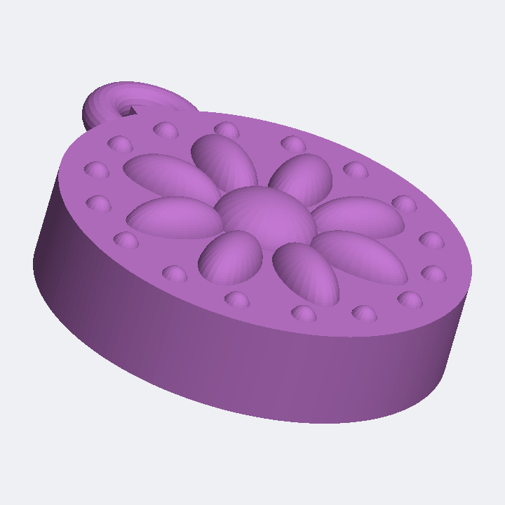
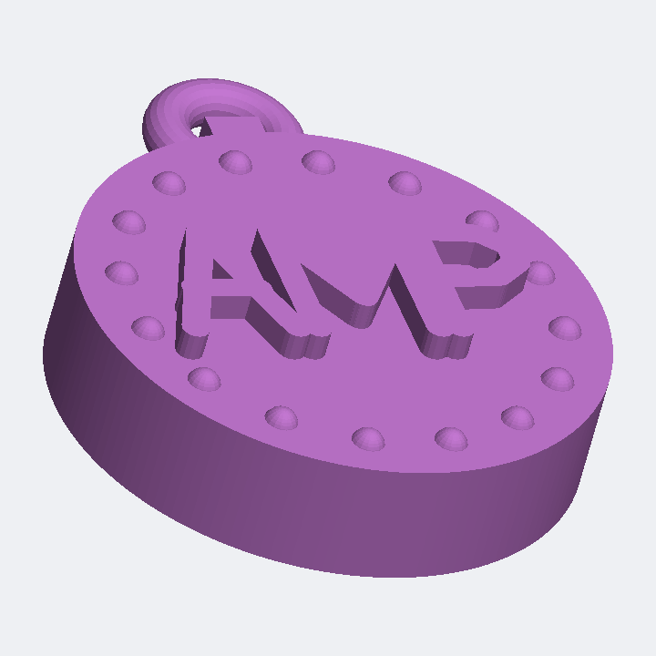
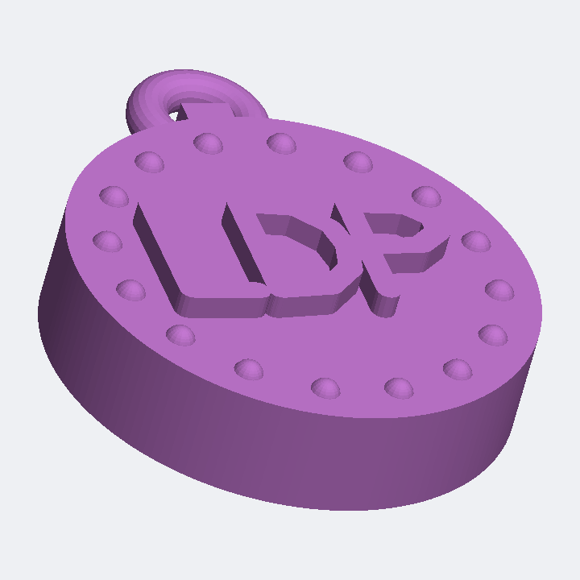
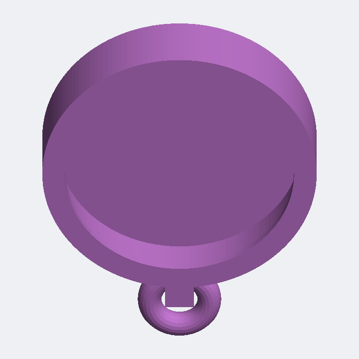
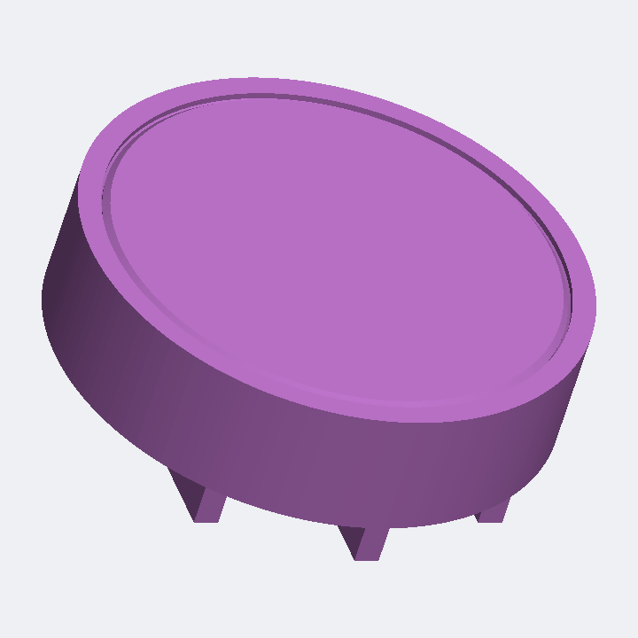
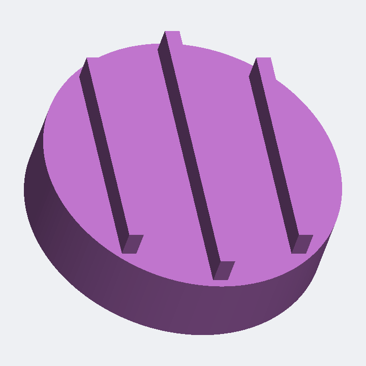

# SeekTag Decorative Shell

A decorative snap-in case for a round **SeekTag / AirTag-style tracker**
(SeekTag `TAG03NC`, CR2032-powered, ~40 mm dia × ~8 mm thick). The tracker
snaps into the back; the front shows a raised flower / mandala relief, and a
keyring loop at the top lets you hang it from keys, a bag, or a zipper.

Two front styles are included: a **flower/mandala** and a **monogram** with
your initials.






## Monogram variants (ready to print)

Personalised initials, each in two cavity sizes. All share the dot-ring border
and keyring loop; only the initials and cavity size differ.

| File | Initials | Case OD | Fits tracker |
|---|---|---|---|
| `seektag_AMP_40mm.stl` | AMP | 46 mm | 40 mm dia × 8 mm |
| `seektag_AMP_42mm.stl` | AMP | 48 mm | 42 mm dia × 8 mm |
| `seektag_LDP_40mm.stl` | LDP | 46 mm | 40 mm dia × 8 mm |
| `seektag_LDP_42mm.stl` | LDP | 48 mm | 42 mm dia × 8 mm |

**Which size?** Print a **40 mm** first — that's the usual size for these round
SeekTags. If the tracker measures larger or seats loosely, use the **42 mm**.
Fine-tune tension with `FIT_CLEARANCE` (see below) rather than jumping sizes.

Regenerate all four with:

```bash
python3 generate_variants.py
```

To change the letters or make new initials, edit `INITIALS` / `SIZES` in
`generate_variants.py`, or set `TEXT` directly. The built-in stroke font
currently covers the letters **A D L M P** (the ones these initials need); add
more glyphs to the `_FONT` table in `generate_shell.py` for other letters.

| | |
|---|---|
| Case outer diameter | **46 mm** |
| Case height | **11 mm** (up to ~14.4 mm at the flower peak) |
| Cavity | **40.8 mm dia × 8.5 mm deep** |
| Fits tracker | 40 mm dia × 8 mm (with 0.4 mm radial + 0.5 mm depth clearance) |
| Retaining lip | 1.2 mm overhang — snaps over the tracker edge |
| Keyring loop | 10 mm OD ring, 4 mm hole |

## Files

- `generate_shell.py` — parametric generator (pure Python, **no dependencies**).
  Set `STYLE = "flower"` or `"monogram"` and `TEXT = "..."` at the top.
- `generate_variants.py` — builds all monogram variants (initials × sizes).
- `seektag_decorative_shell.stl` — the flower model (ASCII STL).
- `seektag_<INITIALS>_<size>.stl` — the monogram models.
- `shoe_case.py` + `shoe_base.stl` / `shoe_lid.stl` — the lace-in shoe case.
- `validate.py` — checks each primitive is watertight and that the decorations
  don't intrude into the tracker cavity.
- `render_preview.py` — dependency-free software renderer for the preview PNGs.

## Regenerating / resizing

Everything is parametric. **Measure your tracker with calipers** and edit the
values at the top of `generate_shell.py` — most importantly:

```python
TRACKER_DIA   = 40.0   # your tracker's diameter
TRACKER_THICK = 8.0    # your tracker's thickness
FIT_CLEARANCE = 0.4    # loosen (0.5) if too tight, tighten (0.3) if too loose
```

Then:

```bash
python3 generate_shell.py seektag_decorative_shell.stl   # rebuild the STL
python3 validate.py                                      # sanity-check it
python3 render_preview.py                                # refresh previews
```

You can also restyle the front: `PETAL_COUNT`, `PETAL_LEN`, `PETAL_RISE`,
`DOT_COUNT`, `CENTER_BOSS_R`, etc.

## Lace-in shoe case

A two-part case that laces onto a shoe and seals the tracker inside.




- `shoe_base.stl` — tracker cup raised on ribs; the two channels between the
  ribs are **enclosed lace tunnels** (roof = sealed floor, walls = ribs, floor
  = the shoe). Thread a shoelace end through each tunnel.
- `shoe_lid.stl` — plain low-profile cap that **snaps** onto the base, sealing
  the tracker (floor below + lid above = sealed on both sides).

| | |
|---|---|
| Case outer diameter | 48.4 mm |
| Assembled height | 17.2 mm |
| Cavity | 40.8 mm dia × 8.4 mm deep |
| Lace tunnels | 2 × ~11.6 mm wide × 4.8 mm high |

**Printing:** both parts print flat with **no supports**. Print the base
rib-side down (cavity opening up); the sealed floor only bridges the ~12 mm
tunnel gaps. Print the lid flat.

**Assembly:** drop the tracker into the base, press the lid on until the snap
bead clicks over its edge. The snap is a light interference fit — FDM results
vary, so if the lid is too tight or won't seat, raise `CLEARANCE`; if it's
loose, lower `SNAP` or `CLEARANCE` in `shoe_case.py` and re-run
`python3 shoe_case.py`. To permanently seal it, add a drop of glue on the shelf
before pressing the lid.

**Lacing:** unlace the shoe a couple of crosses, pass each lace end through one
tunnel (so the case sits flat over the tongue area), then re-lace. Adjust the
tunnel spacing with `RIB_X` if your lace pitch differs.

Regenerate with `python3 shoe_case.py`. Tracker size, tunnel size, wall
thicknesses, and snap tolerances are all parameters at the top of that file.

## Printing notes

- **Orientation:** print with the **open cavity facing down** (decorative
  front up). No supports needed; the keyring loop bridges fine at this size.
- **Material:** PLA or PETG. PETG gives the snap lip a bit more springiness.
- **Settings:** 0.2 mm layers, 3 walls, 15–20% infill.
- **Fit:** the tracker snaps past the 1.2 mm lip and is held by it. If your
  slicer/printer runs tight, bump `FIT_CLEARANCE` to 0.5 and reprint. The mesh
  is a union of individually watertight solids, so slicers merge it into one
  solid body automatically.

## How it's built

The model is a union of watertight primitives (a slicer merges overlapping
solids into one object):

- **Body** — a solid of revolution whose cross-section carves out the cavity
  and the inward snap lip.
- **Decorations** — flat-based domes (half-ellipsoids) for the petals, centre
  boss, and accent dots. Being flat-based, they rise off the front face but
  never dip into the cavity behind the front wall.
- **Keyring loop** — a torus plus a short neck bridging it to the body rim.
